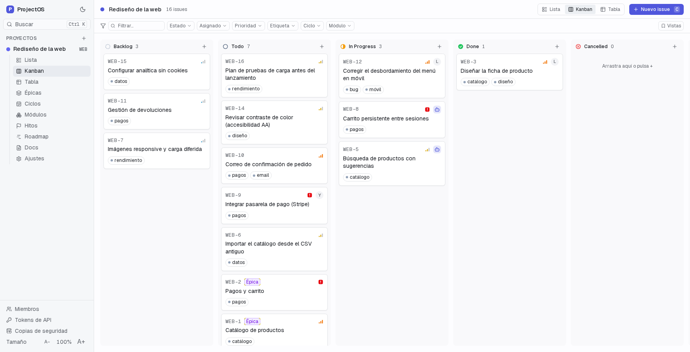
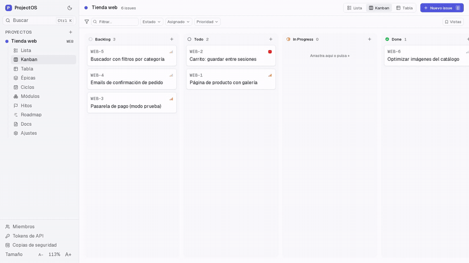
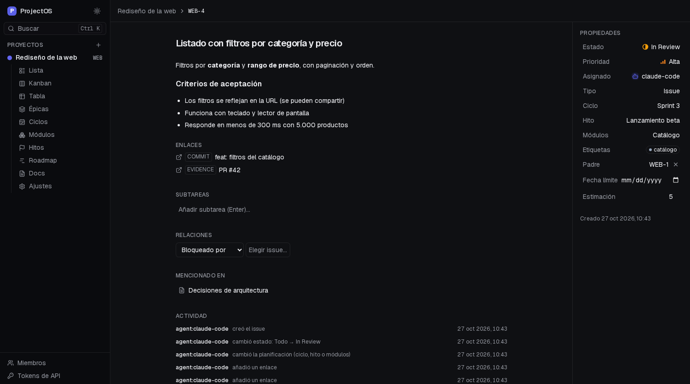
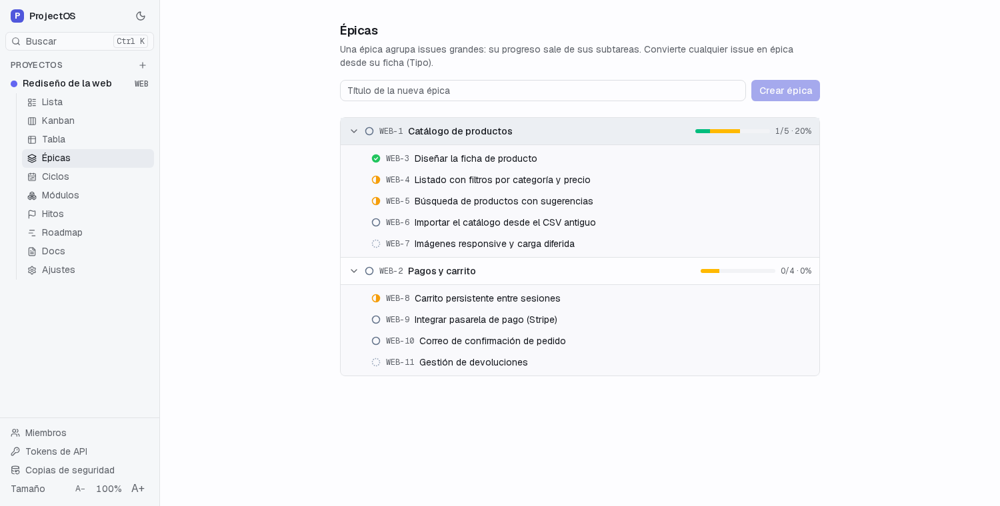

<div align="center">

# ProjectOS

**Un gestor de proyectos local y privado, hecho para que lo manejen agentes de IA.**
Tú ves cómo va; el agente hace el 90 % del trabajo de mantenerlo al día.


[Instalar](#instalación) · [Primeros pasos](#primeros-pasos) · [Agentes](#trabajar-con-agentes) · [Documentación](#documentación)



<sub>Proyecto de ejemplo. Los datos de las capturas no son reales.</sub>

</div>

---

## ¿Qué es?

ProjectOS es un gestor de proyectos **pensado desde el principio para agentes de IA** (Claude Code y cualquier cliente MCP).
Un agente puede leer qué toca hacer, cambiar el estado de una tarea, anotar avances con pruebas (commits, PR) y cerrar lo que
está terminado, todo por una API con permisos y sin herramientas de borrado. Tú abres la interfaz cuando quieres ver el estado.

Corre en **tu ordenador**: sin cuentas, suscripciones, límites ni nube. Tus datos están en una carpeta tuya. Y si vienes de
Linear (rapidez, teclado, interfaz sobria) o de Plane (módulos, ciclos, documentos, propiedades propias), encontrarás lo mismo.

```
   Tú ──── navegador ────┐
                         ├──►  ProjectOS  ──►  tus datos (carpeta local)
   Agente ── MCP / REST ─┘     (localhost)
```

<div align="center">


<sub>Un agente toma una tarea, anota avances con su commit y la cierra. Demo con datos ficticios (la pantalla se recarga tras cada paso).</sub>
</div>

## Qué puedes hacer

| | |
|---|---|
| **Trabajo diario** | Issues con estados propios por proyecto, prioridad, etiquetas, subtareas, relaciones (bloquea, duplica), asignados (personas y agentes), propiedades personalizadas, fechas y estimaciones. Vistas **Lista, Kanban y Tabla** con filtros, vistas guardadas y paleta de comandos (`Ctrl K`) |
| **Planificación** | Épicas con progreso, ciclos, módulos, hitos y roadmap |
| **Documentos** | Páginas en Markdown con enlaces bidireccionales (`[[FICH-12]]`) e historial de versiones |
| **Agentes** | 41 herramientas por MCP y REST, permisos `read` / `write`, **sin herramientas de borrado**, cada cambio registrado como `agent:<nombre>` |
| **Tus datos a salvo** | Copia automática diaria con rotación, copias manuales, restauración con simulación previa, importador de Plane |
| **Comodidad** | Tema claro y oscuro, tamaño de interfaz ajustable, diseño móvil, accesibilidad auditada (WCAG 2.1 AA) |

<table>
<tr>
<td width="50%"><br><sub><b>La ficha de un issue</b>: lo que hizo el agente queda con pruebas.</sub></td>
<td width="50%"><br><sub><b>Épicas</b>: el progreso sale de las subtareas.</sub></td>
</tr>
</table>

## Instalación

**Necesitas** [Node 24+](https://nodejs.org) y [pnpm 9](https://pnpm.io/installation). No hace falta Docker ni instalar ninguna base de datos:
ProjectOS lleva PostgreSQL embebido y guarda todo en `./data`.

```bash
git clone https://github.com/EzequielMenor/ProjectOS.git projectos
cd projectos
pnpm install
pnpm build
pnpm start
```

Abre **http://localhost:3000**. Se abre vacío: crea tu primer proyecto desde la propia aplicación.

> Por defecto la aplicación **solo escucha en tu propio ordenador** (`127.0.0.1`). No tiene inicio de sesión, así que no la
> abras a tu red sin leer [`docs/security.md`](docs/security.md).

**¿Quieres que esté siempre encendida?** En Linux hay un servicio de usuario listo (`scripts/projectos.service`): arranca solo
y se reinicia si falla. Pasos, actualizaciones y copias de seguridad en [`docs/install.md`](docs/install.md).

## Primeros pasos

1. **Crea un proyecto.** Elige un identificador corto (`WEB`, `FICH`…): tus issues serán `WEB-1`, `WEB-2`…
2. **Crea algo de trabajo** con el botón *Nuevo issue* (o la tecla `C`) y arrástralo entre columnas en el Kanban. Pulsa `Ctrl K`
   para buscar o saltar a cualquier sitio.
3. **Conecta a un agente** (siguiente apartado).

La guía completa de funciones, con atajos, filtros, épicas, documentos y propiedades, está en [`docs/usage.md`](docs/usage.md).

## Trabajar con agentes

1. En la aplicación, abre **Tokens de API** y crea un token: `write` para un agente que trabaja, `read` para uno que solo consulta.
   Ponle el nombre del agente (`claude-code`): así sabrás quién hizo cada cambio.
2. Justo debajo aparece **«Configurar en el agente»**, ya rellena con tu token. Tienes tres opciones:
   - **Claude Code**: un comando para copiar y pegar.
   - **Otros clientes MCP**: el JSON de configuración.
   - **Prompt para el agente**: un texto detallado que pegas en el agente y él se configura solo (se registra, busca su proyecto,
     añade la sección a su `CLAUDE.md` y se da de alta como miembro).

   En Claude Code el comando tiene esta forma:

   ```bash
   claude mcp add --transport http --scope user projectos http://localhost:3000/api/mcp \
     --header "Authorization: Bearer pos_XXXX"
   ```

3. Dile al agente qué hacer: *«Mira qué toca en el proyecto WEB y empieza por lo más urgente»*. Al conectarse recibe un acuerdo
   de trabajo: pide la siguiente tarea (`next_work`), la lee, la marca en curso, anota avances **con evidencia** (commit, PR,
   resultado de tests) y solo cierra lo que está verificado.

**Lo que un agente puede y no puede hacer.** Puede crear y editar issues, comentar, planificar (ciclos, módulos, hitos),
escribir documentos y crear proyectos y estados. **No puede borrar nada ni tocar la estructura sensible** (renombrar o borrar
proyectos y estados, tokens, copias de seguridad): eso queda para ti, en la interfaz. Detalle en [`docs/agents.md`](docs/agents.md).

## Documentación

| Quiero… | Lee |
|---|---|
| Instalar, dejarlo siempre encendido, actualizar o restaurar copias | [`docs/install.md`](docs/install.md) |
| Aprender a usar la aplicación | [`docs/usage.md`](docs/usage.md) |
| Conectar y gobernar agentes | [`docs/agents.md`](docs/agents.md) |
| Saber qué protege y qué no | [`docs/security.md`](docs/security.md) |
| Entender cómo está hecho | [`docs/architecture.md`](docs/architecture.md) |
| Tocar el código, correr los tests | [`docs/development.md`](docs/development.md) |
| Traer mis proyectos de Plane | [`docs/migration.md`](docs/migration.md) |
| Ver qué se ha hecho y qué falta | [`docs/roadmap.md`](docs/roadmap.md) · [`CHANGELOG.md`](CHANGELOG.md) |

## Seguridad en tres líneas

- Escucha solo en `127.0.0.1` por defecto y **no tiene inicio de sesión**: pensado para una persona en su propio equipo.
- Los tokens de los agentes se guardan como hash, tienen permisos y se pueden revocar. No hay herramientas de borrado.
- Tus datos viven en `./data` (fuera de git). Haz copias: la app guarda una al día, pero en el mismo disco.

## Estado del proyecto

**Versión 0.1.0.** Verificado: la lógica y las herramientas del agente (tests unitarios), los flujos de la interfaz, el móvil
emulado y la accesibilidad (tests de navegador), un cliente MCP real conectándose con la configuración que muestra la pantalla,
un Claude Code real completando un ciclo de trabajo, y el servidor de producción con el servicio de systemd en Linux.

**Sin verificar todavía:** Docker Compose (está escrito, no se ha ejecutado), Windows y macOS, un móvil real, y sesiones largas
con agentes reales. Tampoco hay edición de ciclos, módulos e hitos desde la interfaz (solo los agentes pueden editarlos).

Es una aplicación de **una sola persona**: no hay cuentas ni permisos por usuario; los «miembros» son etiquetas para repartir
trabajo.

## Contribuir y licencia

Código abierto bajo licencia [MIT](LICENSE). Los issues y las ideas son bienvenidos: mira [`CONTRIBUTING.md`](CONTRIBUTING.md).

## Para desarrollar

```bash
pnpm dev            # desarrollo (para antes el servidor de producción: la base embebida admite un solo proceso)
pnpm test           # tests unitarios (Vitest)
pnpm test:e2e       # tests de interfaz (Playwright, con una base de datos temporal aparte)
pnpm typecheck && pnpm lint
```

Pila: Next.js 16 · TypeScript · Tailwind + shadcn/base-ui · Drizzle (PGlite o PostgreSQL) · SDK oficial de MCP.
Más en [`docs/development.md`](docs/development.md) y [`docs/architecture.md`](docs/architecture.md).
